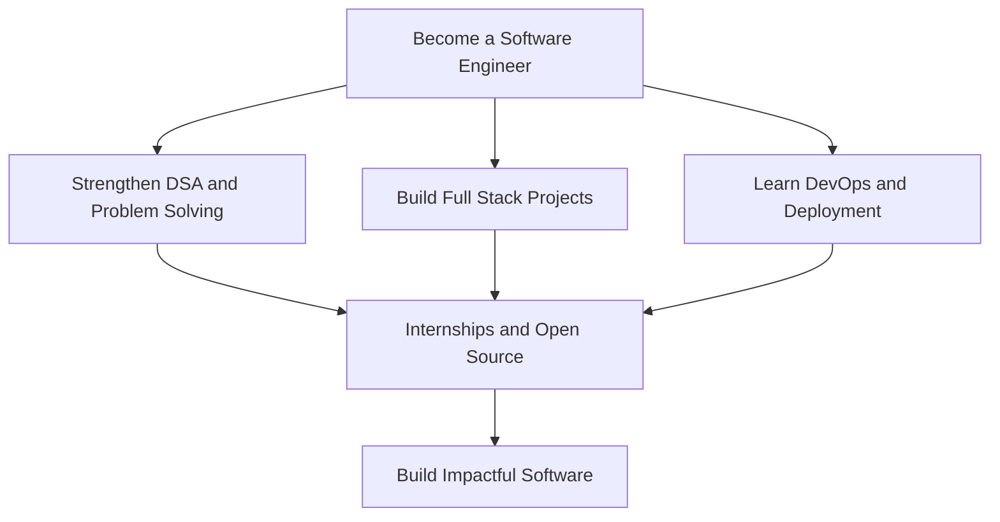

<!-- Personalized GitHub profile README for Krishna H K. -->
<div align="center">
  
</div>

<div align="center">
  
</div>

<p align="center">
  
</p>

<div align="center">
  <a href="https://github.com/Krishna7259?tab=repositories"></a>
  <a href="https://in.linkedin.com/in/krishna-h-k-b600363b7"></a>
  <a href="mailto:krishnahanuma20060920@gmail.com"></a>
</div>

## 👨‍💻 About Me


```yaml
name: Krishna H K
location: Bengaluru, Karnataka, India
education:
  - B.E. in Computer Science and Engineering
  - Diploma in Computer Science and Engineering
college: MVJ College of Engineering, Bengaluru
current_status: Engineering Student
career_goal: Software Engineer / Full Stack Developer
interests:
  - Web and Software Development
  - Artificial Intelligence and Cybersecurity
  - Databases and DevOps
  - Open Source and Problem Solving
currently_learning:
  - Full Stack Development
  - AI and Machine Learning Concepts
  - Software Engineering Practices
```

- 🎓 Pursuing **B.E. in Computer Science and Engineering** at **MVJ College of Engineering, Bengaluru**.
- 💻 Interested in **software engineering, web development, AI, and cybersecurity**.
- 🔭 Working on practical projects in **virtual try-on, file encryption, smart waste management, and threat detection**.
- 🌱 Improving my **data structures, algorithms, backend development, and deployment** skills.
- 🎯 Goal: Become a skilled **software developer** and contribute to meaningful technology projects.

<br clear="right" />

## 🛠️ Tech Arsenal

<div align="center">

### 💻 Programming Languages


### 🌐 Web Development


### 🗄️ Databases


### 🔧 Tools & Development Environment


</div>

<p align="center"></p>

## 🚀 Featured Projects

### ♻️ CleanOurLand — Smart Waste Reporting and Management
A project concept for reporting garbage problems using photos and location information, assigning cleaning tasks, and recording cleanup progress.

**Planned features:** Citizen reporting, image uploads, location capture, worker assignment, progress tracking, and before/after photos.

**Status:** In development / planning.

### 👓 Smart Web-Based Virtual Try-On System
An e-commerce mini-project using computer vision to overlay virtual eyeglasses on a face from a photo or webcam feed.

**Technologies explored:** Python, Flask, HTML, CSS, JavaScript, MediaPipe Face Landmarker.

**Focus:** Facial landmarks, automatic positioning, scaling, rotation, and product overlays.

### 🔐 File Encryption Using AES and XOR
A Java-based security mini-project for protecting files with encryption and a user-friendly Swing interface.

**Technologies:** Java, Swing, Cryptography APIs.

**Focus:** File selection, password-based encryption and decryption, and data security.

### 🛡️ AI-Based Cyber Threat Detection in Unidirectional IP Traffic
A research-oriented project exploring passive network traffic analysis and machine learning for cyber threat classification and severity scoring.

**Focus:** Flow metadata, anomaly/threat classification, severity visualization, and reporting.

> Project descriptions reflect work and ideas explored; replace these sections with repository links and confirmed results as projects are completed.

<div align="center">
  <a href="https://github.com/Krishna7259?tab=repositories"></a>
</div>

## 📊 GitHub Statistics

<div align="center">
  
  
  <br />
  
</div>

## 📈 Contribution Activity

<div align="center">
  
</div>

## 🏆 GitHub Trophies

<div align="center">
  
</div>

## 🎯 Current Mission



## 📬 Connect With Me

<div align="center">
  <a href="https://in.linkedin.com/in/krishna-h-k-b600363b7"></a>
  <a href="mailto:krishnahanuma20060920@gmail.com"></a>
  <a href="https://github.com/Krishna7259"></a>
  <br /><br />
  
  
</div>

<div align="center">
  
  <p><i>Keep learning, keep building, and keep improving! 🚀</i></p>
</div>
